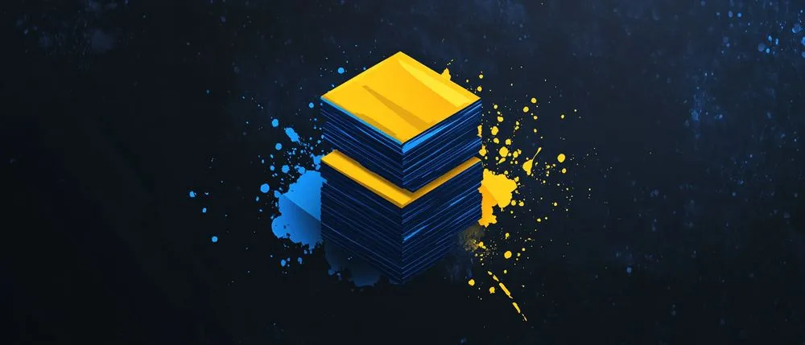

# image-manifest

[](https://www.npmjs.com/package/image-manifest)
[](https://github.com/vdistortion/image-manifest/actions/workflows/tests.yaml)
[](https://coveralls.io/github/vdistortion/image-manifest?branch=main)

A CLI tool to batch-convert and resize images (webp, avif, jpg, png) and generate a JSON manifest — for static sites and galleries.

[](https://image-manifest.zvalentin.com)

## Quick Start

```sh
npx image-manifest@latest --json manifest
```

## Local Web UI

Run `npx image-manifest --ui` to open the local browser interface. Choose an output format (WebP, AVIF, JPG, PNG, or keep the original), set independent maximum width and height limits, and start processing. The same button can stop the batch after the current image finishes. The interface follows your browser language and light/dark theme preferences.

See the [full documentation](https://image-manifest.zvalentin.com) for all options, interactive mode, configuration files, and programmatic API usage.

> ⭐ Like this tool? Give it a star on [GitHub](https://github.com/vdistortion/image-manifest) – it helps others discover the project!
